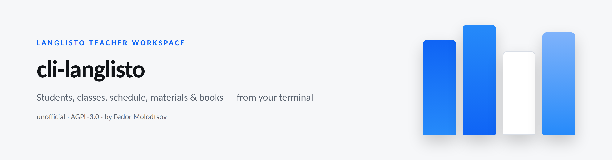

<picture>
  <source media="(prefers-color-scheme: dark)" srcset="assets/banner-dark.png">
  
</picture>

<p align="center"><sub><b>Fedor Molodtsov</b> — AI automation engineer · <a href="https://github.com/itsfedor">github.com/itsfedor</a></sub></p>

# ⌨️ cli-langlisto: drive LangListo from your terminal

**An unofficial CLI for [LangListo](https://app.langlisto.com) — the ESL teaching
platform — with a bundled agent skill.**

[](https://www.python.org/)
[](LICENSE)
[](skills/cli-langlisto/SKILL.md)

> **Note:** v1.1.0 renamed the project to **`cli-langlisto`** (previously `cli-anything-langlisto`). The old command name still works as an alias.

LangListo keeps students, classes, the schedule and all lesson materials inside
a Vite SPA with **no public API**. This project reverse-engineered the JSON API
and wraps it in a small, scriptable CLI — so you *(or your AI agent)* can set up
a whole school workspace from the command line instead of clicking through the UI.

Built out of a real, urgent need: moving a working ESL practice off Edvibe
after its outage — 12 students, 9 classes, a full weekly schedule and lesson
materials, all rebuilt on LangListo in one evening with these exact commands.

## Installation

Requires **Python 3.9+**. No Node, no server, no extras.

```bash
pipx install git+https://github.com/itsfedor/cli-langlisto
```

Or clone + pip:

```bash
git clone https://github.com/itsfedor/cli-langlisto
cd cli-langlisto
pip install -e .
```

Check the setup:

```bash
cli-langlisto doctor
```

Then log in once — the session token is cached at `~/.langlisto/session.json`
(mode 600); your password is never stored and never leaves your machine:

```bash
cli-langlisto login        # asks for email + hidden password
```

Non-interactive alternative for scripts:

```bash
export LANGLISTO_EMAIL="you@example.com"
export LANGLISTO_PASSWORD="..."
```

> The CLI only works with *your* account: every request runs from your machine,
> under your login. Nothing is shared between users.

## Use cases

**1 · Import students, classes and the schedule.**

```bash
cli-langlisto students add --name "Nadia"            # + --email or --domain
cli-langlisto classes create --name "Nadia — English" --kind individual \
    --student nadia@example.com
cli-langlisto schedule add --class "Nadia — English" --at "2026-11-03 14:00" --duration 60
cli-langlisto schedule list --days 3
```

Hand each student their login in one command — `students creds <name> --link`
returns a ready sign-in link (passwords stay out of your way).

**2 · Build a full lesson material from one JSON spec.**

Describe the lesson once — sections, exercises, answers, model answers, media —
then let the CLI build it inside a course on the Materials shelf:

```bash
cli-langlisto materials build lesson.json --course "B1" --dry-run   # review the plan
cli-langlisto materials build lesson.json --course "B1"             # build (resumable)
```

Types: notes, articles, essays with hidden model answers, match-pairs, typed
gaps with answer keys, quizzes (single/multi), images, audio and video —
local media files are uploaded to the platform automatically. Flag a section
`"homework": true` and its items are authored into the unit's homework bucket
(«Exercises for homework») instead of a visible section. The spec format
is documented in [`skills/cli-langlisto/references/lesson-spec.md`](skills/cli-langlisto/references/lesson-spec.md).

**3 · Design books on your shelf** — courses with covers, grouped in folders:

```bash
cli-langlisto folders create --title "My Series"
cli-langlisto courses create --title "Book A" --description-file desc.html
cli-langlisto courses cover "Book A" --file cover.png
```

<p align="center">
  
  
</p>

**4 · Anything else** — `raw METHOD /path` is an escape hatch to the whole
API; `--json` makes every command scriptable.

**5 · Verify a build before students see it.**

```bash
cli-langlisto materials verify "Book A"                          # whole book (read-only)
cli-langlisto materials verify "Book A" --lesson "1.5 Have got"  # one lesson
cli-langlisto materials verify "Book A" --min-note-coverage 0.8  # gate → exit 1 below 80%
cli-langlisto materials verify "Book A" --state lesson.json.state.json   # state↔live diff
cli-langlisto materials verify "Book A" --strict --json
```

Checks live data: counts, type distribution, empty content, missing answers,
image captions, teacher-notes coverage (essay/voice/free-gap), duplicate
sections/items (normalized hashes), state↔live drift and the render-safety
lint. Exit codes: `0` clean, `1` problems (documented below), `2` usage.
Read-only by default; `--grading` additionally spot-checks answer keys via
`POST /exercises/{id}/trial-check`.

**6 · Mass-run a spec catalog (resumable).**

```bash
cli-langlisto materials run specs/ --state specs/run-state.json --pace 1.0
cli-langlisto materials run 'specs/A1/*.json' --state run.json \
    --only a-an-plurals --retry-failed --limit 10 --dry-run
cli-langlisto materials status --state bgp/run-state.json 'bgp/specs/A1/*.state.json'
```

`run` skips specs already `done`, retries `failed` only with `--retry-failed`,
writes a run-state JSON and exits non-zero if any build failed. `status`
summarizes run-state and builder state files (done/failed/warnings, build
time). `materials tree "Book A"` now drills down to exercise level.

**7 · Books & exercises housekeeping.**

```bash
cli-langlisto books modules add "Book A" --title "Module 1 · Basics"   # idempotent
cli-langlisto books modules rename "Book A" --module <id|title> --title "…"
cli-langlisto books lessons order "Book A" --ids id1,id2               # or --file order.json (module-aware)
cli-langlisto books purge-starter "Book A" --dry-run                   # untitled + empty lessons only
cli-langlisto exercises show <exercise-id>
cli-langlisto exercises notes <exercise-id> --text "Model answer…" [--visible-to-student]
cli-langlisto exercises notes <exercise-id> --from-file key.txt
cli-langlisto exercises order --section <section-id> --ids a,b,c       # first id → position 0 (banner)
cli-langlisto exercises patch <exercise-id> --suffix note --body-file body.json
cli-langlisto exercises delete <exercise-id>
```

**8 · Student-view preview & student records.**

```bash
cli-langlisto preview open --next /my-classes   # prints a demoview.langlisto.com URL (single-use)
cli-langlisto students patch "Nadia" --email new@example.com   # 409 student_email_taken → clear hint
cli-langlisto students unenroll "Nadia" --class "Nadia — English"
cli-langlisto students verify "Nadia" --class "Nadia — English"  # exit 1 when not a member
```

`preview open` wraps the platform's own «Demo preview» mechanism
(`POST /demo-student/open`, the same call as «Test student» → «Log in as a
student»): it returns a magic-link URL for the synthetic demo student — no
real account is touched and the CLI never stores the URL.
It also deep-links the class room:
`preview open --class <cid> [--unit <uid>] [--tab lesson|homework]` opens
`/classrooms/{cid}/room?unit=…&tab=homework` for the demo student — the
fastest way to see exactly what a student's Homework tab shows.

**9 · Classroom homework — the room's «Homework» tab from the CLI.**

```bash
cli-langlisto homework bucket --unit <uid>                            # prepared homework («Exercises for homework»)
cli-langlisto homework prepare --unit <uid> --section Homework        # migrate a visible section; deletes it!
cli-langlisto homework list --class "Nadia — English"                 # units with homework
cli-langlisto homework list --class "CLI Lab (test)" --student "Demo Student"  # personal statuses
cli-langlisto homework available --class <cid> --unit <uid>           # Lesson + workbook groups
cli-langlisto homework available --class <cid> --unit <uid> --from-material <matUnit>
cli-langlisto homework choose --class <cid> --unit <uid> --exercise <src-id>... --dry-run
cli-langlisto homework choose --class <cid> --unit <uid> --exercise <src-id>...
cli-langlisto homework assigned --class <cid> --unit <uid>            # source ids in place
cli-langlisto homework show --class <cid> --unit <uid>                # what the student sees
cli-langlisto homework remove --class <cid> --unit <uid> --exercise <src-id>
cli-langlisto homework clear --class <cid> --unit <uid> --exercise <id>,<id>...
cli-langlisto homework review --class <cid> --unit <uid>              # submissions per student
cli-langlisto homework accept --class <cid> --unit <uid> --student <sid>
cli-langlisto homework return --class <cid> --unit <uid> --student <sid> --comment "Fix Q2"
```

Homework content is authored into the unit's **workbook bucket** — the
editor's «Exercises for homework» group; students only see it once assigned.
`homework bucket` lists what is prepared; `homework prepare` migrates a lesson
that keeps homework in a visible section (moves the whole section into the
bucket and deletes the emptied one — cascading to the students' answers on it
— unless `--keep-section`). Building a material flags the same routing with a
spec section `"homework": true`.

The room's «Homework» tab is the hidden per-unit homework section: `choose`
**copies** the selected exercises there and the student gets a separate
Homework tab with submit / revision / completed states. Every operation is
keyed by the **(classroom, unit)** pair — `classroom_id` is always sent — and
exercises are addressed by their **source ids** (the ids you see in the
lesson or material), never by the copy ids. `choose` is idempotent (re-choosing
is a no-op) and `choose --dry-run` prints the exact payload with labels
resolved. `homework show` is the only command that reads the homework exactly
as the student sees it, without a browser. With `--from-material <matUnit>`
the picker's «Choose from other materials» path is used: the Lesson group is
read from another unit (a book/material), the target stays the classroom
unit. Student-side `homework submit` is **deferred** — the CLI holds your
teacher token only; drive the platform's demo student instead:
`preview open --class <cid> --unit <uid> --tab homework`. Full flow + rules:
[`skills/cli-langlisto/references/homework.md`](skills/cli-langlisto/references/homework.md).

**10 · Lesson sections & covers.**

```bash
cli-langlisto sections list --unit <uid> [--class <cid>]
cli-langlisto sections reorder --unit <uid> --ids sec2,sec1     # PUT …/sections/order (array order)
cli-langlisto sections delete --section <sid> [--unit <uid>]    # destructive; --unit reads the list back
cli-langlisto units cover set --unit <uid> --file cover.png     # or --url https://…
cli-langlisto units cover clear --unit <uid>
```

Platform limits worth knowing: section **duplicate** and section **visibility**
do not exist (no route / silently ignored); the only native header-like visual
for a section is the `image_stack` banner — place it first with
`exercises order --section <sid> --ids banner,…`. A unit cover is the lesson's
only native visual and renders in lesson pickers and book lists.

> `--json` is a **global** flag: put it before the subcommand
> (`cli-langlisto --json materials verify "Book A"`).

## For AI agents

The repo **bundles an agent skill** ([`skills/cli-langlisto`](skills/cli-langlisto/SKILL.md))
with the command map, house rules (login is the human's step; additive-only;
dry-run first) and troubleshooting notes. Install it with:

```bash
npx skills add itsfedor/cli-langlisto -g -y          # any SKILL.md agent
hermes skills install itsfedor/cli-langlisto/skills/cli-langlisto
```

`INSTALL.md` is written for agents — paste it (or the message at its top) to
your assistant and it will do the whole install.

## How it works

LangListo's API is a standard Bearer-token JSON API
(`https://app.langlisto.com/api/v1`); the CLI authenticates once, caches the
token, and speaks the endpoints the web app itself uses — students, classrooms,
lessons/schedule, course units, sections, exercises of every type, folders and
uploads. All networking is Python stdlib (`urllib`) — no exotic dependencies.
A quiet pace between calls keeps bulk operations friendly to the platform.

## Safety

- **Additive by design** — destructive commands are explicit and few:
  `schedule rm` (lessons you explicitly want removed), `exercises delete`,
  `books purge-starter` (untitled + empty starter lessons only),
  `students unenroll` (membership link only — the account survives),
  `sections delete` and `homework prepare` without `--keep-section` (both
  drop a section's exercises and students' answers). Other homework writes
  are reversible: `homework choose` copies exercises into the unit's hidden
  homework section, `remove` / `clear` take them out by source id; `accept` /
  `return` only set the review status.
- `materials verify` is **read-only** unless you pass `--grading` (which only
  sends trial checks — never student-visible attempts). What fails it:
  empty content, missing answers, render-lint hazards, duplicate
  sections/items, and — with `--min-note-coverage` — thin teacher-notes
  coverage. Missing image captions and state↔live drift are reported as
  warnings (exit stays 0) unless `--strict` is set.
- Works **only with your own account**, from your own machine.
- Never stores your password; `logout` clears the cached token. The demo
  preview URL (`preview open`) is printed once and never persisted.

## License

AGPL-3.0 — see [LICENSE](LICENSE). Commercial license:
[COMMERCIAL.md](COMMERCIAL.md). Not affiliated with LangListo; use with your
own account and data.
